# DEV-ROOT — PHASE 6 AUDIT REPORT

**Date:** October 2026  
**Auditor:** Dev-root Engineering & Educational Architecture  
**Scope:** Full-Stack Projects, Career Readiness, Production Readiness, Debugging, Testing, and Curriculum Depth  
**Workspace:** `z:\Dev Root\Dev-Root`  

---

## 1. Executive Summary

Phases 1 through 5 established a solid web development learning platform with 12 active courses, 31 core lessons, 10 interactive coding challenges, 10 comprehensive course assessments, a 10-tier project curriculum, and persistent localStorage tracking (`devroot_progress_v1`).

However, as a platform striving to take learners from **absolute zero to independent full-stack engineers capable of architecting, testing, deploying, and explaining production-grade software**, critical educational and architectural gaps were identified. Specifically:

1. **Courses 13 through 16 existed only as planned outlines** in `courses.js` without full-depth lesson content for testing, professional debugging, production deployment, and career readiness.
2. **Project Workspace lacked crucial educational scaffolding**: although 10 project tiers existed with starter code and milestones, projects were missing direct cross-references to relevant Dev-root lessons, linked coding challenges, interactive testing verification checklists, learner notes persistence, and distinct project statuses (`not_started`, `in_progress`, `completed`, `needs_revision`).
3. **Debugging was treated informally** across scattered lessons rather than as a structured engineering discipline with dedicated curricula for frontend DevTools, JavaScript runtime diagnosis, backend/database failure modes, and end-to-end distributed tracing.
4. **Testing lacked a cohesive hands-on curriculum**: learners were introduced to concepts in passing without systematic training in unit testing (Vitest), component testing (React Testing Library), API integration testing (Supertest), and E2E user journeys (Playwright).
5. **Deployment instruction was theoretical**: lacking deep breakdowns of Vite production build pipelines, environment variable and cloud secrets hygiene, CORS architecture, HTTPS/DNS, containerization, and post-deployment monitoring.
6. **No interactive Production-Readiness Checklist**: learners had no standardized, reusable tool to evaluate whether their application is ready for real-world traffic across functionality, accessibility (WCAG AA), security (OWASP Top 10), reliability, and performance.
7. **Career Readiness & Portfolio Building were absent**: learners lacked guided tools to translate academic code into professional portfolios, write production-grade README specifications, prepare for rigorous full-stack technical interviews, and practice technical communication.

Phase 6 addresses all seven areas directly, applying the permanent **Four-Times Content-Depth Requirement** to every new lesson and architectural tool.

---

## 2. Current Implementation Audit

### 2.1 Existing Courses and Lessons (Courses 1–12)

| Course ID | Title | Lessons | Word Count Est. | Status | Quality Assessment |
| :--- | :--- | :--- | :--- | :--- | :--- |
| `course-1` | Understanding the Web | 2 lessons | ~9,500 words | Complete | High depth, clear diagrams and HTTP breakdowns. |
| `course-2` | Developer Environment & Git | 3 lessons | ~11,000 words | Complete | Shell commands, VS Code, Git CLI workflows. |
| `course-3` | HTML5 Foundations | 3 lessons | ~15,000 words | Complete | Semantic markup, forms, accessibility, validation. |
| `course-4` | CSS Foundations & Styling | 4 lessons | ~18,000 words | Complete | Box model, flexbox, CSS grid, responsive design. |
| `course-5` | Modern CSS Architecture | 2 lessons | ~10,000 words | Complete | Custom properties, design tokens, responsive cards. |
| `course-6` | JavaScript Fundamentals | 3 lessons | ~14,000 words | Complete | Primitives, control flow, functions, arrays/objects. |
| `course-7` | Modern JavaScript (ES6+) | 2 lessons | ~11,000 words | Complete | Arrow functions, destructuring, modules, async/await. |
| `course-8` | The DOM & Browser APIs | 2 lessons | ~9,500 words | Complete | Selection, manipulation, events, localStorage. |
| `course-9` | React from Zero | 2 lessons | ~11,000 words | Complete | JSX, components, props, useState, useEffect. |
| `course-10` | Backend with Node.js | 2 lessons | ~10,500 words | Complete | Runtime, modules, Express routing, middleware. |
| `course-11` | Databases & MongoDB | 2 lessons | ~10,000 words | Complete | NoSQL concepts, Mongoose schemas, CRUD queries. |
| `course-12` | Authentication & Security | 2 lessons | ~11,500 words | Complete | Passwords, bcrypt, JWT, RBAC, web security. |
| **Courses 13–16** | **Testing, Debugging, Deployment, Career** | **0 active** | **0 words** | **Planned (Gap)** | **Identified as primary curriculum gap in Phase 6.** |

### 2.2 Project-Based Learning Path (`src/data/projects.js` & `ProjectDetail.jsx`)

- **Strengths**: 10 distinct project tiers ranging from semantic HTML personal profiles to full-stack municipal redressal systems (CRP India case study). Includes overview, learning objectives, suggested architecture, starter files, step-by-step milestones with subtasks, and progressive hints/solutions.
- **Deficiencies Identified**:
  - Missing cross-links to specific Dev-root lessons to study before starting each milestone.
  - Missing cross-links to relevant coding challenges that practice prerequisite algorithms or DOM skills.
  - Testing checklist tab contained static text rather than an interactive, persistent verification tool.
  - No workspace note-taking facility for learners to document architecture decisions, local setup steps, or API keys.
  - Project status was derived solely from whether all milestone checkboxes were toggled; did not support explicit states (`not_started`, `in_progress`, `completed`, `needs_revision`).

### 2.3 Interactive Features & Learning Tools

- **Interactive Code Editor (`CodeEditor.jsx`)**: Working sandbox for HTML/CSS and JavaScript execution.
- **Coding Challenges (`Challenges.jsx`, `ChallengeDetail.jsx`)**: 10 active challenges with automated test execution, hint reveal mechanics, and solution walkthroughs.
- **Assessments (`Assessments.jsx`, `AssessmentDetail.jsx`)**: 10 comprehensive assessments with randomized question display, explanations, and persistent scoring.
- **Revision Center (`Revision.jsx`)**: Bookmarked lessons, flagged assessment questions, and streak analytics.
- **Gaps**:
  - No interactive Production-Readiness checklist tool.
  - No Portfolio Project Builder for custom learner capstone projects.
  - No Technical Interview Preparation center with output prediction and debugging challenges.

### 2.4 State Persistence & Progress Tracking (`ProgressContext.jsx`)

- Stored in `localStorage` under key `devroot_progress_v1`.
- Tracks: `completedLessons`, `quizScores`, `completedExercises`, `completedChallenges`, `challengeAttempts`, `projectMilestones`, `bookmarkedLessons`, `flaggedQuestions`, `assessmentScores`, and `streakData`.
- **Phase 6 Requirements**: Must safely migrate and extend this schema to include `projectNotes`, `projectStatusOverride`, `productionChecklist`, `interviewAttempts`, and `portfolioProject` without resetting or altering any existing learner progress.

### 2.5 Test Suite and Build Health

- 36 Vitest tests passing across routing, UI components, content validation, and progress tracking.
- Vite production build succeeds cleanly in ~3.5s with zero syntax or bundling errors.

---

## 3. Phase 6 Strategic Roadmap

To fulfill all requirements of the Phase 6 specification, the implementation is structured into five core pillars:

```mermaid
graph TD
    A[Phase 6 Platform & Curriculum Expansion] --> B[Pillar 1: Curriculum Depth & New Courses]
    A --> C[Pillar 2: Enhanced Project Workspace]
    A --> D[Pillar 3: Interactive Production Checklist]
    A --> E[Pillar 4: Career Readiness & Interview Prep]
    A --> F[Pillar 5: Portfolio Project Builder]

    B --> B1[Course 13: Full-Stack Testing & QA]
    B --> B2[Course 14: Professional Debugging]
    B --> B3[Course 15: Production Deployment & DevOps]
    B --> B4[Course 16: Career Mastery & System Design]

    C --> C1[Direct Lesson & Challenge Cross-Links]
    C --> C2[Interactive Testing Verification Checklist]
    C --> C3[Persistent Project Notes Editor]
    C --> C4[Explicit Project Status Management]

    D --> D1[WCAG AA, OWASP, CWV Audit Checklist]
    D --> D2[Self-Reported vs Automated Distinction]
    D --> D3[Actionable Remediation Guidance]

    E --> E1[40+ Interactive Full-Stack Interview Questions]
    E --> E2[Code Reading & Output Prediction]
    E --> E3[Confidence Rating & Progress Tracking]

    F --> F1[Guided 9-Step Architectural Planner]
    F --> F2[Automated Dev-Root Lesson Recommendations]
    F --> F3[One-Click Production README & Architecture Export]
```

---

## 4. Acceptance Criteria Checklist

- [x] Initial audit conducted and documented in `docs/PHASE_6_AUDIT.md`.
- [ ] Implement Course 13: Full-Stack Testing & Quality Assurance (4 deep lessons).
- [ ] Implement Course 14: Professional Debugging & Troubleshooting (4 deep lessons).
- [ ] Implement Course 15: Production Deployment, Cloud & DevOps (4 deep lessons).
- [ ] Implement Course 16: Career Readiness & Technical Interview Mastery (4 deep lessons).
- [ ] Upgrade Project Workspace with linked lessons, linked challenges, interactive testing checklists, notes persistence, and status controls.
- [ ] Build interactive Production-Readiness Checklist tool (`/production-checklist`).
- [ ] Build interactive Technical Interview Prep Center (`/interview-prep`).
- [ ] Build interactive Portfolio Project Builder (`/portfolio-builder`).
- [ ] Extend `ProgressContext.jsx` with backward-compatible schema enhancements.
- [ ] Update Navigation, Routing, and Home dashboard showcases.
- [ ] Add unit and component test suites in `src/test/Phase6FullStack.test.jsx`.
- [ ] Execute test suite (`npx vitest run`) and production build (`npm run build`).
- [ ] Complete full Phase 6 documentation suite (8 documents).
- [ ] Safely commit and push to `origin main`.
- [ ] Deliver comprehensive 17-point final report.
